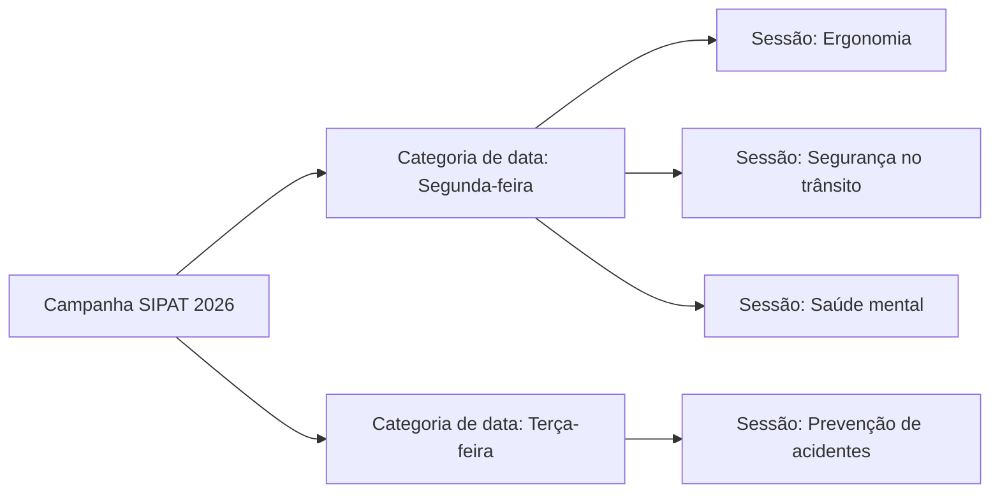
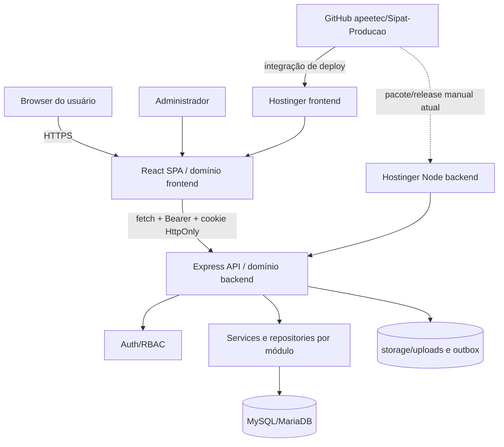
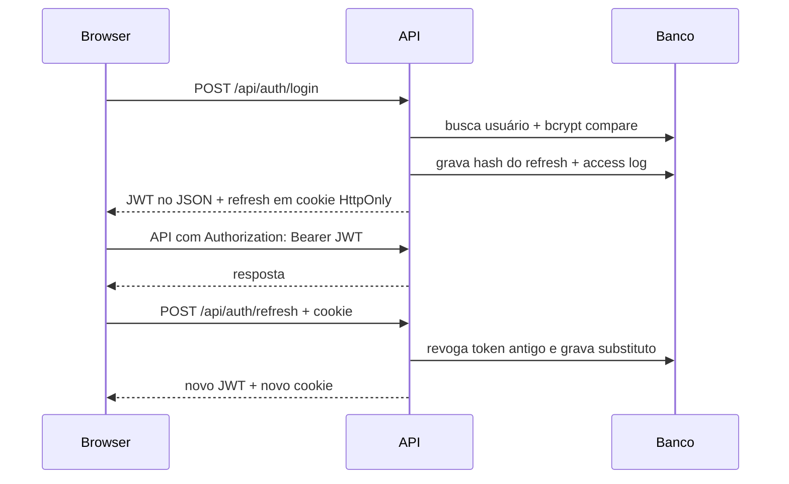

# Portal SIPAT Honda 2026 — Guia técnico completo para humanos e IAs

**Status do documento:** canônico

**Data da auditoria:** 2026-11-02

**Escopo auditado:** frontend, backend, schema SQL, testes, automação GitHub e arquivos de deploy presentes no repositório

**Regra de confiança:** fatos externos ao Git, como opções exatas do hPanel, são identificados como “configuração externa” ou “inferência operacional”.

## 1. Resumo executivo

O Portal SIPAT é uma aplicação web corporativa para organizar e executar a Semana Interna de Prevenção de Acidentes do Trabalho. Ela atende dois grupos:

- **colaboradores**, que autenticam, concluem primeiro acesso, aceitam regulamento, acessam sessões, comprovam presença ou assistem a vídeo, respondem questionários e consultam vencedores;
- **administradores**, que gerenciam datas, sessões, perguntas, unidades, usuários, resultados, sorteios, configurações, personalização, relatórios e auditoria.

O sistema é full-stack, separado em dois deploys:

- uma SPA React estática no domínio `https://khalifadeveloper.com.br`;
- uma API Node.js no domínio `https://backendportfolio.khalifadeveloper.com.br`, conectada ao MySQL/MariaDB da Hostinger.

A aplicação também preserva um modo demonstrativo local. Quando `VITE_API_URL` está vazio, o frontend seleciona um adaptador baseado em armazenamento local e seeds. Esse modo existe para demonstração e testes de interface; ele não representa a fonte de verdade de produção.

## 2. Glossário do domínio

| Termo | Significado no sistema |
|---|---|
| Organização | Tenant lógico superior, atualmente a organização Honda |
| Campanha | Uma edição da SIPAT, por exemplo SIPAT 2026 |
| Unidade | Unidade fabril ou concessionária à qual um usuário pode estar vinculado |
| Categoria de data / `EventDate` | Data agrupadora criada pelo administrador; funciona como categoria da programação |
| Sessão / evento / `EventDay` | Conteúdo individual com janela, vídeo/presença e questionário; várias sessões podem compartilhar uma data |
| Participação | Estado de um usuário em uma sessão: acesso, modalidade, vídeo, submissão e pontuação |
| Regulamento | Versão publicável do termo que o usuário deve aceitar |
| Sorteio | Operação administrativa que seleciona elegíveis e mantém snapshots auditáveis |
| Soft delete | Exclusão lógica por `deleted_at`, preservando histórico e relações |

### Distinção essencial: data versus sessão

`event_dates` e `event_days` não são sinônimos.



Uma categoria de data tem uma data de calendário única dentro da campanha e pode agrupar qualquer quantidade de sessões. Uma sessão só pode ser criada ou movida para categoria ativa. A categoria não pode ser excluída enquanto houver sessão vinculada.

## 3. Stack tecnológica

### 3.1 Frontend

| Camada | Tecnologia | Papel |
|---|---|---|
| Linguagem | TypeScript | Tipagem estática e contratos |
| UI | React 19 | Componentização e estado de interface |
| Rotas | React Router DOM 7 | SPA, lazy loading e guards |
| Build/dev | Vite 8 | Servidor local e bundle de produção |
| CSS | Tailwind CSS 4 + CSS custom properties | Layout, responsividade e tema |
| Componentes | shadcn local + Radix UI | Primitivos acessíveis e customizáveis |
| Ícones | Lucide React | Iconografia |
| Datas | date-fns + date-fns-tz + react-day-picker | Calendário e conversão São Paulo/UTC |
| CSV | PapaParse | Importação e validação |
| Excel | write-excel-file | Exportação sem a dependência vulnerável `xlsx` |
| Testes | Vitest | Testes unitários |

### 3.2 Backend

| Camada | Tecnologia | Papel |
|---|---|---|
| Runtime | Node.js 20.19+; produção recomendada 22.x | Execução da API |
| Linguagem | TypeScript 5.9, ESM/NodeNext | Código compilado para `dist/` |
| HTTP | Express 5 | Rotas e middlewares |
| Validação | Zod 4 | `body`, `query` e `params` estritos |
| Banco | mysql2/promise | Pool e transações SQL parametrizadas |
| Senhas | bcryptjs | Hash de senhas e códigos de presença |
| Tokens | jsonwebtoken + tokens opacos | JWT de acesso e refresh rotativo |
| Segurança HTTP | Helmet, CORS, express-rate-limit | Headers, origem e abuso |
| Upload | Multer + file-type | Streaming/armazenamento e inspeção binária |
| Logs | Pino + pino-http | Logs estruturados e request IDs |
| E-mail | Nodemailer | SMTP ou outbox `.eml` local |
| API docs | swagger-ui-express | OpenAPI navegável |
| Testes | Vitest + Supertest | Unidade e integração HTTP/MySQL |

### 3.3 Persistência e infraestrutura

- MySQL/MariaDB com InnoDB e `utf8mb4`.
- phpMyAdmin para importação/inspeção na Hostinger.
- UUID textual `CHAR(36)` como chave predominante.
- SPA estática servida por Apache com `.htaccess`.
- Aplicação Node separada, com suporte documentado a Hostinger Node App ou PM2 em VPS.
- GitHub como repositório remoto e Hostinger integrada ao repositório para o frontend.

## 4. Arquitetura de alto nível



### 4.1 Por que existem dois adaptadores no frontend

`src/services/repositories/index.ts` escolhe a implementação no carregamento:

- com `VITE_API_URL`: repositórios HTTP, autenticação real e MySQL;
- sem `VITE_API_URL`: adaptador local, seed e `localStorage`.

Isso facilita prototipação, mas cria uma obrigação: toda regra crítica deve existir no servidor. O modo local pode simular comportamento; ele não deve definir segurança nem autorizar decisões de produção.

## 5. Estrutura do repositório

```text
.
├── .github/workflows/                 # Automação do frontend
├── public/                            # Assets copiados pelo Vite, inclusive .htaccess
├── src/
│   ├── app/                           # Router, providers e guards
│   ├── components/
│   │   ├── feedback/                  # Toasts
│   │   ├── layout/                    # Shells, header, banner, sidebar e drawer
│   │   └── ui/                        # Design system local/shadcn
│   ├── features/                      # Páginas e fluxos por domínio
│   ├── services/
│   │   ├── api/                       # Cliente Node e fachada de casos de uso
│   │   ├── exports/                   # CSV/XLSX seguros
│   │   └── repositories/              # Interfaces + adaptadores HTTP/local
│   ├── seed/                          # Dados somente do modo demo
│   ├── types/                         # Tipos de domínio compartilhados no frontend
│   └── utils/                         # Datas, segurança e transformação
├── tests/unit/                        # Testes do frontend
├── backend/
│   ├── src/
│   │   ├── config/                    # Ambiente e logger
│   │   ├── database/                  # Pool, query e transação
│   │   ├── docs/                      # OpenAPI em código
│   │   ├── middlewares/               # Auth, segurança e erro
│   │   ├── modules/                   # Admin, auth, events, draws etc.
│   │   ├── scripts/                   # Bootstrap administrativo
│   │   ├── shared/                    # Schemas, erros e utilitários
│   │   ├── app.ts                     # Composição Express
│   │   └── server.ts                  # Inicialização e graceful shutdown
│   ├── tests/                         # Segurança, datas e integração MySQL
│   ├── deploy/                        # Exemplo de proxy Nginx
│   └── storage/                       # Persistência runtime ignorada pelo Git
├── database/
│   ├── schema.sql                     # DDL completo oficial
│   ├── create-database.sql            # Criação local do banco
│   └── migrations/                    # Mudanças incrementais
├── scripts/setup-local.ps1            # Provisionamento local/XAMPP
├── docs/                              # Documentação técnica e operacional
├── package.json                       # Frontend e orquestração local
└── components.json                    # Configuração shadcn
```

## 6. Frontend em profundidade

### 6.1 Inicialização

`src/main.tsx` inicializa o React. `src/App.tsx` hospeda o router. `AppProviders` carrega as configurações públicas da campanha, aplica CSS variables de tema, inicializa autenticação e disponibiliza notificações.

As páginas são importadas com `React.lazy`, reduzindo o bundle inicial. A tela de fallback da SPA depende do rewrite do Apache para `index.html`; sem `public/.htaccess`, acessar diretamente `/login` ou `/admin/dias` retorna 404.

### 6.2 Rotas da interface

| Caminho | Acesso | Função |
|---|---|---|
| `/login` | Público | Autenticação por matrícula e senha |
| `/primeiro-acesso` | Usuário autenticado pendente | Definição obrigatória de nova senha |
| `/regulamento` | Usuário autenticado | Leitura e aceite da versão publicada |
| `/` | Protegido | Home com programação e estado das sessões |
| `/dias/:slug` | Protegido | Presença/vídeo, questionário e resultado da sessão |
| `/ganhadores`, `/sorteios` | Protegido | Galeria de sorteios publicados |
| `/admin` | Admin | Dashboard |
| `/admin/datas` | Admin | Categorias de data |
| `/admin/dias` | Admin | Sessões/eventos vinculados às datas |
| `/admin/perguntas` | Admin | Perguntas e alternativas |
| `/admin/unidades` | Admin | Unidades e contagem de vínculos |
| `/admin/usuarios` | Admin | CRUD, reset de participação e seleção |
| `/admin/usuarios/importar` | Admin | Importação em massa |
| `/admin/usuarios/excluir-em-massa` | Admin | Soft delete em lote |
| `/admin/resultados` | Admin | Matriz de respostas e exportações |
| `/admin/sorteios` | Admin | Prévia, execução, histórico e anulação |
| `/admin/auditoria` | Admin | Logs de ação e acesso |
| `/admin/configuracoes` | Admin | Regras e parâmetros da campanha |
| `/admin/personalizacao` | Admin | Marca, cores, textos e imagens |
| `/ferramentas/validar-csv` | Admin | Validador de arquivo para importação |

### 6.3 Guards

- `ProtectedRoute`: exige autenticação, primeiro acesso concluído e regulamento aplicável aceito.
- `FirstAccessRoute`: só permite o fluxo de troca quando o usuário está autenticado e `mustChangePassword` é verdadeiro.
- `AdminRoute`: exige usuário autenticado, sem pendência de primeiro acesso e com role `admin`.

Esses guards melhoram navegação, mas não substituem RBAC no servidor.

### 6.4 Estado de autenticação

- O JWT de acesso é mantido em memória.
- O refresh token é cookie `HttpOnly`, `Secure` em produção e `SameSite=Lax`.
- O `localStorage` contém apenas um marcador de que havia sessão (`sipat_auth_user_id`), usado para decidir se vale tentar refresh ao recarregar.
- Se a API responde 401 por access token expirado, o cliente tenta uma rotação de refresh e repete a requisição de forma controlada.
- A aplicação não deve chamar `/auth/refresh` sem marcador; isso evita 401 ruidoso para visitantes sem sessão.

### 6.5 Contratos e acesso a dados

`interfaces.ts` define repositórios de usuário, unidade, data, evento, pergunta, participação, sorteio, auditoria e configuração. O adaptador HTTP converte nomes e formatos do frontend para o contrato REST. A fachada `backend-service.ts` agrega casos de uso e contém implementações locais quando a API está desativada.

Ao adicionar campo:

1. atualizar o tipo de domínio;
2. atualizar a interface do repositório;
3. mapear entrada/saída no adaptador HTTP;
4. atualizar a fachada, se necessário;
5. atualizar componente e teste;
6. fazer a mudança correspondente no backend e no OpenAPI.

### 6.6 Datas e fuso

- Categoria usa `YYYY-MM-DD`, sem hora.
- Sessões usam `opensAt` e `closesAt` ISO com offset.
- A UI interpreta entradas no fuso `America/Sao_Paulo`.
- O banco recebe/gera timestamps UTC.
- Não use `new Date('YYYY-MM-DD')` para exibição local sem utilitário; isso pode deslocar o dia.

### 6.7 Estilização e design system

O visual usa Tailwind 4 e variáveis CSS em `src/index.css`. A configuração shadcn está em `components.json`, estilo `new-york`, ícones Lucide e aliases para `@/src/...`.

Paleta base auditada:

| Token | Valor base | Uso |
|---|---:|---|
| brand primary | `#028056` | marca e ações principais |
| primary dark | `#015237` | hover/contraste |
| deep green | `#014730` | superfícies escuras |
| action green | `#66bd39` | destaque/CTA |
| background | `#e2e8e8` | fundo neutro |
| graphite | `#323f3c` | texto/estrutura |
| gold | `#f59e0b` | alertas e premiação |
| accent | `#667eea` | acento secundário |

As configurações do banco podem sobrescrever cores/textos em runtime por CSS variables. Fontes principais: Inter e Montserrat.

Princípios de responsividade:

- `AdminShell` alterna sidebar para drawer móvel;
- tabelas usam contêiner com overflow horizontal e larguras mínimas controladas;
- formulários mudam de múltiplas colunas para uma coluna em telas menores;
- diálogos respeitam altura da viewport e rolagem interna;
- `DatePicker` e `DateTimePicker` preservam os formatos esperados pelo backend.

Atenção: o diretório `ui` combina arquivos PascalCase legados e arquivos shadcn minúsculos. O Windows não evidencia todos os problemas de caixa; o build Linux do GitHub/Hostinger é a validação final.

### 6.8 Exportações

- CSV: UTF-8 com BOM e separador compatível com o uso esperado.
- Excel: `write-excel-file`.
- Células iniciadas por `=`, `+`, `-` ou `@` devem ser neutralizadas para evitar formula injection.
- A antiga dependência `xlsx` foi removida por vulnerabilidade; não reintroduzi-la sem análise explícita.

## 7. Backend em profundidade

### 7.1 Organização em camadas

O backend é modular e pragmático:

- **routes**: composição de URL, auth, rate limit e validação;
- **controllers**: tradução HTTP e status;
- **services**: regras transacionais e orquestração;
- **repositories**: SQL e mapeamento de dados;
- **middlewares/shared**: infraestrutura transversal.

Nem todo módulo possui os quatro arquivos, mas a responsabilidade permanece separada. Essa estrutura pode ser transposta para MVC/service layer em PHP sem mudar o modelo conceitual.

### 7.2 Bootstrap do servidor

`server.ts` valida conectividade do banco antes de ouvir a porta. O encerramento em `SIGTERM`/`SIGINT` fecha o servidor e o pool, com limite de segurança. Isso é importante em restart da Hostinger/PM2.

### 7.3 Pipeline HTTP

Na ordem principal:

1. request context e `X-Request-Id`;
2. Pino HTTP;
3. honeypot;
4. Helmet/CSP;
5. CORS restritivo com credentials;
6. compressão;
7. parsers com limites;
8. cookie parser;
9. rate limit global;
10. rotas `/api` e alias `/api/v1`;
11. Swagger opcional;
12. 404 e error handler mascarado.

### 7.4 Autenticação



- JWT: issuer `sipat-api`, audience `sipat-web`, TTL configurável.
- Refresh: valor aleatório opaco; somente SHA-256 é armazenado; rotação a cada uso.
- Login falho usa mensagem genérica para não enumerar usuários.
- Primeiro acesso exige nova senha com no mínimo 8 caracteres, letra e número. No comportamento atual, `currentPassword` é opcional nesse endpoint porque o usuário já foi autenticado; troca normal exige senha atual.
- Aceite só é permitido para regulamento publicado da campanha e versão solicitada.

### 7.5 Segurança implementada

- Helmet e remoção de `X-Powered-By`;
- CORS com lista exata e cookies;
- limites global, login, sensível e lotes administrativos;
- honeypots para caminhos de scanner como `.env`, `.git`, WordPress e phpMyAdmin;
- bloqueio temporário em memória para IP acionado pelo honeypot;
- Zod `.strict()` em entradas;
- SQL parametrizado;
- sanitização allowlist do HTML do regulamento;
- hashes HMAC de IP em logs, em vez de IP em claro;
- erros internos e stack trace mascarados em produção;
- MIME declarado + assinatura binária em uploads;
- nomes UUID e proteção de path traversal;
- auditoria de operações sensíveis.

Limitação operacional conhecida: rate limit geral e bloqueio honeypot residem na memória do processo. Reinício limpa o estado e múltiplas instâncias não compartilham contagem. Se houver escala horizontal, usar store compartilhado, por exemplo Redis. O limite de código de presença, por outro lado, está no banco e sobrevive a reinícios.

## 8. Regras de negócio detalhadas

### 8.1 Usuários e unidades

- Matrícula e e-mail são únicos por organização.
- Role é `admin` ou `collaborator`.
- Usuário pode não ter unidade; a FK usa `SET NULL` caso uma exclusão física excepcional aconteça.
- Exclusão de usuário é soft delete e desativação.
- Não é permitido excluir o próprio usuário da sessão.
- Não é permitido desativar/excluir o último administrador ativo.
- Exclusão em lote aceita até 500 IDs e usa transação/lock para preservar essas regras.
- Reset de participação aceita usuários selecionados e, opcionalmente, uma sessão. Respostas são soft-deleted; participação volta a `in_progress`, limpa submissão e nota, mas preserva a liberação já conquistada por presença/vídeo.
- A contagem de usuários da unidade inclui vínculos não excluídos e é calculada no SQL.
- Unidade com qualquer usuário não excluído vinculado não pode ser removida.

### 8.2 Datas e sessões

- Uma campanha não pode ter duas categorias com a mesma data.
- Várias sessões podem pertencer à mesma categoria.
- O slug da sessão é único por campanha.
- `closesAt` deve ser posterior a `opensAt`.
- Categoria inativa não aceita nova associação nem movimentação; sessão que já pertence a ela pode ser editada sem mudar de categoria.
- A alteração do rótulo da categoria propaga `date_label` às sessões vinculadas.
- Sessões e categorias são excluídas por soft delete.
- Sessão pode contar ou não para o critério de semana completa.
- Vídeo pode ser URL externa ou attachment servido pela API, com override por unidade.

### 8.3 Acesso à sessão e presença

- Colaborador só vê sessão ativa cuja categoria não esteja inativa.
- Operações de presença, progresso e submissão exigem que o relógio esteja dentro da janela da sessão.
- Código é normalizado para maiúsculas e comparado com bcrypt.
- São permitidas no máximo 5 tentativas por usuário/sessão em um minuto; tentativas e resultado ficam em `attendance_attempts`.
- Presença válida define modalidade `in_person` e libera o questionário.

### 8.4 Vídeo e anti-cheat

- A primeira atualização não pode iniciar acima de 30 segundos.
- Atualizações seguintes são serializadas com `FOR UPDATE`.
- O avanço permitido é aproximadamente posição anterior + tempo transcorrido × 1,75 + tolerância de 20 segundos.
- Progresso inválido retorna 422.
- Percentual persistido é monotônico (`GREATEST`), nunca diminui.
- Ao alcançar o threshold configurado, `video_completed_at` é preenchido e o questionário é liberado.
- `client_event_id` suporta unicidade/idempotência de eventos reportados.

### 8.5 Perguntas e submissão

- Tipos: escolha única, texto livre e avaliação.
- Somente escolha única pode ser pontuada.
- Pergunta pontuada exige exatamente uma alternativa correta.
- Gabarito só é incluído para o participante depois da submissão e conforme fluxo de revisão/configuração.
- Perguntas obrigatórias precisam de resposta compatível com o tipo.
- A alternativa enviada deve pertencer à pergunta.
- Submissão usa transação e `FOR UPDATE`; segunda submissão retorna 409.
- Todas as respostas são gravadas em `participation_answers` antes de marcar a participação como submetida.
- Percentual = corretas/pontuadas × 100, com duas casas.
- `perfectScore` só é verdadeiro quando existe ao menos uma pergunta pontuada e todas estão corretas.

### 8.6 Sorteios

- Apenas colaboradores ativos e não excluídos são elegíveis.
- Escopo diário: participação submetida e nota perfeita na sessão escolhida.
- Semana completa: nota perfeita em todas as sessões ativas marcadas `counts_for_full_week`; deve existir ao menos uma sessão válida.
- Pode filtrar unidades.
- Pode excluir vencedores de sorteios publicados anteriores da campanha.
- Preview não sorteia nem persiste resultado.
- Execução usa transação, `GET_LOCK` por campanha, Fisher-Yates e `crypto.randomInt`.
- A quantidade efetiva é limitada ao total elegível.
- O sistema salva snapshot de todos os elegíveis e dados dos vencedores.
- Sorteio publicado não é apagado; pode ser anulado com justificativa, usuário e horário.
- Galeria pública mostra apenas publicados e mascara matrícula conforme configuração.

### 8.7 Regulamento e configurações

- Regulamentos são versionados por campanha.
- Aceite é único por regulamento/usuário e registra data, user-agent resumido e hash de IP.
- HTML passa por sanitização no servidor.
- Configurações controlam marca, textos, links, imagens, threshold de vídeo, exibição de respostas e máscara de matrícula.

### 8.8 Uploads e relatórios

- Imagens permitidas: JPEG, PNG e WebP.
- Vídeos permitidos: MP4, WebM, OGG e QuickTime, conforme validação implementada.
- Limites vêm de `MAX_UPLOAD_IMAGE_MB` e `MAX_UPLOAD_VIDEO_MB`.
- Arquivos ficam em `backend/storage/uploads` por padrão e precisam de persistência entre releases.
- Endpoint público aceita somente nome no padrão UUID permitido e usa cache imutável.
- Relatório aceita CSV/XLSX até 20 MB, valida MIME/extensão e assinatura ZIP do XLSX.
- Envio usa SMTP em produção ou grava `.eml` em outbox local.

## 9. Variáveis de ambiente

### 9.1 Frontend

| Variável | Necessidade | Observação |
|---|---|---|
| `VITE_API_URL` | Obrigatória em produção | Origem da API; aceita origem ou URL terminando em `/api` |
| `VITE_DEMO_ADMIN_PASSWORD` | Somente demo local | Nunca usar em produção |
| `VITE_DEMO_COLLABORATOR_PASSWORD` | Somente demo local | Nunca usar em produção |

Toda `VITE_*` é pública no JavaScript compilado.

### 9.2 Backend por grupo

- Processo: `NODE_ENV`, `PORT`, `HOST`, `API_PREFIX`, `PUBLIC_BASE_URL`.
- Banco: `DATABASE_HOST`, `DATABASE_PORT`, `DATABASE_NAME`, `DATABASE_USER`, `DATABASE_PASSWORD`, `DATABASE_CONNECTION_LIMIT`.
- Contexto: `DEFAULT_ORGANIZATION_SLUG`, `DEFAULT_CAMPAIGN_SLUG`.
- Auth: `JWT_ACCESS_SECRET`, `JWT_ACCESS_TTL`, `REFRESH_TOKEN_TTL_DAYS`, `COOKIE_NAME`, `PASSWORD_BCRYPT_ROUNDS`.
- Rede/segurança: `CORS_ORIGINS`, `TRUST_PROXY`, `IP_HASH_SECRET`, rate limits e `HONEYPOT_BLOCK_MS`.
- Observabilidade/docs: `LOG_LEVEL`, `SWAGGER_ENABLED`.
- Arquivos: `UPLOAD_DIR`, limites de imagem/vídeo.
- E-mail: `EMAIL_MODE`, outbox, remetente e `SMTP_*`.
- Bootstrap: `BOOTSTRAP_ADMIN_*`, apenas temporariamente.

Não registrar valores reais na documentação. O backend valida requisitos e combinações na inicialização.

## 10. Testes e qualidade

### 10.1 Frontend

Os testes cobrem parser CSV, elegibilidade, agrupamento de sessões, exportação Excel, matriz de participação, payload de pergunta, score e segurança/timezone.

### 10.2 Backend

- `security.test.ts`: middlewares, auth/segurança e superfícies HTTP.
- `event-dates.test.ts`: regras de categoria de data.
- `mysql-api.integration.test.ts`: fluxo contra MySQL real, com banco temporário.

### 10.3 Pipeline local canônico

```bash
npm ci
npm --prefix backend ci
npm run verify:all
```

`verify:all` executa typecheck, testes e builds das duas aplicações. Para integração real, iniciar XAMPP/MariaDB e usar o teste específico. Nunca apontar esse teste para produção.

## 11. Estado operacional auditado

- Branch atual e remota principal: `main`.
- Frontend em produção foi observado atualizando após push para `main`.
- O workflow publica `dist` em `hostinger-frontend`. Durante a auditoria ela esteve temporariamente defasada, mas alcançou o source commit `2a1d812` em seguida, confirmando que a automação está operacional. A branch efetivamente servida pelo hPanel continua sendo configuração externa ao repositório.
- Backend requer publicação/restart próprios; não há evidência versionada de CI/CD automático para ele.
- A documentação OpenAPI é servida em `/api/docs` quando `SWAGGER_ENABLED=true`.
- O schema oficial já contém `event_dates`; a migration existe para instalações anteriores.

## 12. Dívidas e riscos conhecidos

1. Dois caminhos potenciais de frontend (`main` com build Hostinger e `hostinger-frontend` com artefatos) podem confundir operação; a geração do artefato funciona, mas a branch conectada no hPanel ainda deve ser confirmada.
2. Backend manual pode ficar atrás do frontend. Fallbacks atuais reduzem impacto em algumas funcionalidades, mas não substituem versionamento/deploy coordenado.
3. Rate limit/honeypot em memória não escala para múltiplas instâncias.
4. `backend-service.ts` acumula lógica do modo demo e fachada HTTP; mudanças devem verificar ambos os modos.
5. Documentos históricos citam Firebase/Firestore; isso não é arquitetura ativa.
6. Upload local exige volume persistente e backup; Git não armazena mídia.
7. Swagger em produção aumenta a superfície de descoberta; manter habilitado apenas conforme política operacional.

## 13. Decisões arquiteturais e trade-offs

### SPA estática + API em subdomínio

- **Decisão:** separar frontend e backend em origens próprias.
- **Benefício:** deploy e escala independentes; frontend pode usar hospedagem estática.
- **Custo:** CORS, cookie cross-origin de subdomínio e coordenação de versões.
- **Invariante:** ambas as origens em HTTPS e CORS exato.

### SQL manual em vez de ORM

- **Decisão:** `mysql2` com repositories e SQL explícito.
- **Benefício:** controle de locks, joins, snapshots e performance; fácil auditar a consulta real.
- **Custo:** mapeamento manual e maior disciplina em migrations.
- **Invariante:** placeholders e transações; nada de concatenar entrada.

### JWT curto + refresh opaco rotativo

- **Decisão:** access token em memória e refresh HttpOnly com hash no banco.
- **Benefício:** reduz exposição a XSS e permite revogação/rotação.
- **Custo:** fluxo de refresh e cookies/CORS mais complexo.
- **Invariante:** nunca armazenar access/refresh em localStorage.

### Soft delete e snapshots

- **Decisão:** preservar entidades e resultados relevantes.
- **Benefício:** auditoria e rastreabilidade de campanhas/sorteios.
- **Custo:** todas as consultas devem filtrar `deleted_at`; dados crescem.
- **Invariante:** operações administrativas relevantes geram log e não apagam história silenciosamente.

### Modo demo local e modo HTTP

- **Decisão:** repository ports com duas implementações.
- **Benefício:** interface pode ser demonstrada sem infraestrutura.
- **Custo:** risco de divergência de comportamento e código duplicado.
- **Invariante:** produção sempre usa API; regra de segurança pertence ao backend.

### Componentes shadcn como código local

- **Decisão:** copiar/adaptar primitivos no projeto sobre Radix.
- **Benefício:** controle de tema, acessibilidade e ausência de runtime proprietário.
- **Custo:** manutenção/atualização passa a ser responsabilidade do repositório.
- **Invariante:** validar teclado, foco, responsividade e build Linux.

### Arquivos de mídia no filesystem

- **Decisão atual:** storage local persistente, não object storage.
- **Benefício:** simplicidade e custo baixo no plano atual.
- **Custo:** backup, volume persistente e escala horizontal exigem atenção.
- **Caminho futuro:** S3-compatible storage mantendo a interface/URL canônica.

### Datas agrupadoras separadas das sessões

- **Decisão:** `event_dates` 1:N `event_days`.
- **Benefício:** várias atividades no mesmo dia e administração clara da programação.
- **Custo:** migration e vínculo obrigatório adicional.
- **Invariante:** sessão sempre possui categoria; categoria com sessões não é excluível.

## 14. Como manter este guia confiável

Atualize este documento quando houver:

- nova entidade, regra ou fluxo;
- mudança de stack/dependência;
- nova variável;
- rota de frontend ou endpoint;
- mudança de autenticação, armazenamento ou segurança;
- alteração de branch, workflow, domínio ou Hostinger;
- nova limitação operacional.

Inclua data da nova auditoria e diferencie claramente fato de inferência externa.
