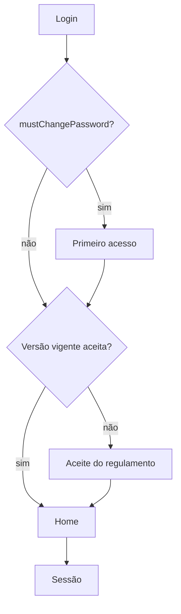
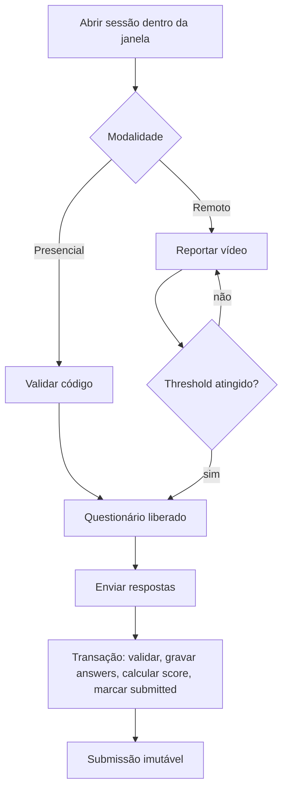
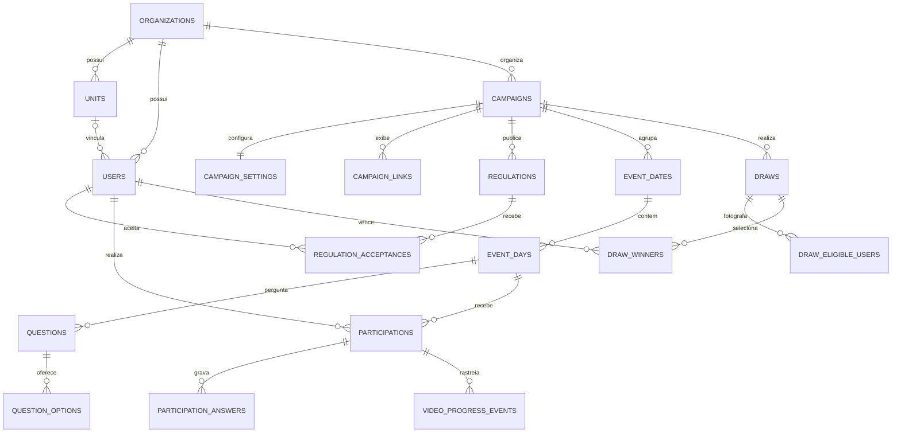

# Referência da API e do banco de dados

**Documento canônico de navegação.** Para schemas exatos de request/response, consulte `backend/src/docs/openapi.ts` ou `/api/docs`. Para DDL exato, consulte `database/schema.sql`. Este documento explica relações, responsabilidades e invariantes que não são óbvias ao ler apenas os contratos.

## 1. Convenções da API

- Prefixo principal: `/api`.
- Alias compatível: `/api/v1` monta o mesmo router.
- JSON é o formato padrão, exceto upload e relatório multipart.
- Autenticação: `Authorization: Bearer <access-token>`.
- Refresh: cookie HttpOnly configurado por `COOKIE_NAME`.
- IDs: UUID.
- Datas/hora: ISO 8601 com offset na borda HTTP; persistência em UTC.
- Paginação de usuários: query de página/limite definida nos schemas compartilhados.
- Objetos de entrada são estritos: campos desconhecidos normalmente geram 422.

### 1.1 Envelope de erro

O error handler usa código estável e mensagem segura; erros internos não expõem stack em produção. Categorias esperadas:

| HTTP | Significado típico |
|---:|---|
| 400 | Requisição semanticamente inválida |
| 401 | Não autenticado, token inválido ou sessão expirada |
| 403 | Autenticado sem permissão, janela fechada ou questionário bloqueado |
| 404 | Recurso inexistente no escopo atual |
| 409 | Conflito de unicidade/estado, como submissão duplicada |
| 413 | Arquivo/payload acima do limite |
| 415 | Mídia não permitida |
| 422 | Falha de validação ou regra de conteúdo |
| 429 | Rate limit |
| 500 | Falha interna mascarada |
| 503 | Banco indisponível no readiness |

O frontend deve tratar `code` quando disponível, não depender exclusivamente do texto traduzido.

## 2. Catálogo de endpoints

Legenda de acesso: **Público**, **Auth** (qualquer usuário autenticado), **Admin**.

### 2.1 Saúde e documentação

| Método | Endpoint | Acesso | Finalidade |
|---|---|---|---|
| GET | `/api/health/live` | Público | Confirma processo vivo; não consulta banco |
| GET | `/api/health/ready` | Público | Consulta banco e retorna 503 se indisponível |
| GET | `/api/docs` | Público/configurável | Swagger UI quando habilitado |
| GET | `/api/openapi.json` | Público/configurável | Documento OpenAPI JSON |

### 2.2 Autenticação

| Método | Endpoint | Acesso | Entrada/efeito principal |
|---|---|---|---|
| POST | `/api/auth/login` | Público | matrícula + senha; retorna JWT e define refresh cookie |
| POST | `/api/auth/refresh` | Cookie | rotaciona refresh e retorna novo JWT |
| POST | `/api/auth/logout` | Público/cookie | revoga refresh e limpa sessão |
| GET | `/api/auth/me` | Auth | usuário público atual |
| POST | `/api/auth/first-access` | Auth | define primeira senha e remove obrigatoriedade |
| POST | `/api/auth/change-password` | Auth | valida senha atual e define nova |
| POST | `/api/auth/accept-regulation` | Auth | aceita versão publicada da campanha |

`login` e `refresh` usam limiter específico. O JWT contém escopo mínimo de organização/campanha/role. Alterações de usuário são rechecadas em `/me` e no próximo ciclo de autenticação.

### 2.3 Conteúdo público

| Método | Endpoint | Acesso | Finalidade |
|---|---|---|---|
| GET | `/api/settings` | Público | configurações e tema da campanha padrão |
| GET | `/api/regulations/current` | Público | regulamento atual publicado |
| GET | `/api/winners?dayId=` | Público | sorteios publicados; matrícula pode vir mascarada |
| GET | `/api/uploads/:kind/:filename` | Público | mídia validada por categoria, nome e tipo |

### 2.4 Experiência do colaborador

| Método | Endpoint | Acesso | Finalidade |
|---|---|---|---|
| GET | `/api/events` | Auth | sessões disponíveis; admin recebe visão ampliada |
| GET | `/api/events/participations/me` | Auth | participações do usuário |
| GET | `/api/events/by-id/:id` | Auth | sessão, questões permitidas, estado e desbloqueio |
| GET | `/api/events/:slug` | Auth | resolve sessão ativa por slug e retorna experiência |
| POST | `/api/events/:id/attendance` | Auth | valida código presencial |
| POST | `/api/events/:id/video-progress` | Auth | registra progresso anti-salto |
| POST | `/api/events/:id/quiz` | Auth | submete respostas uma única vez |

Ordem de rotas importa: `/participations/me` e `/by-id/:id` são declaradas antes de `/:slug`.

### 2.5 Administração de usuários

| Método | Endpoint | Acesso | Finalidade |
|---|---|---|---|
| GET | `/api/admin/users` | Admin | lista paginada, filtros de unidade/role/ativo |
| POST | `/api/admin/users` | Admin | cria com senha temporária |
| POST | `/api/admin/users/reset-participations` | Admin | reseta selecionados, opcionalmente por sessão |
| POST | `/api/admin/users/bulk-delete` | Admin | soft delete em lote, máximo 500 |
| GET | `/api/admin/users/:id` | Admin | detalhe |
| PATCH | `/api/admin/users/:id` | Admin | atualização parcial e senha temporária opcional |
| DELETE | `/api/admin/users/:id` | Admin | soft delete individual |

Proteções: próprio usuário e último admin ativo. Matrícula/e-mail duplicados resultam em conflito.

### 2.6 Unidades

| Método | Endpoint | Acesso | Finalidade |
|---|---|---|---|
| GET | `/api/admin/units` | Admin | lista com `userCount` calculado |
| POST | `/api/admin/units` | Admin | cria unidade |
| GET | `/api/admin/units/:id` | Admin | detalhe com contagem |
| PATCH | `/api/admin/units/:id` | Admin | atualiza |
| DELETE | `/api/admin/units/:id` | Admin | exclui somente sem usuários vinculados |

### 2.7 Categorias de data

| Método | Endpoint | Acesso | Finalidade |
|---|---|---|---|
| GET | `/api/admin/event-dates` | Admin | lista categorias |
| POST | `/api/admin/event-dates` | Admin | cria data agrupadora |
| GET | `/api/admin/event-dates/:id` | Admin | detalhe |
| PATCH | `/api/admin/event-dates/:id` | Admin | atualiza e propaga rótulo às sessões |
| DELETE | `/api/admin/event-dates/:id` | Admin | soft delete somente se vazia |

### 2.8 Sessões/eventos

| Método | Endpoint | Acesso | Finalidade |
|---|---|---|---|
| GET | `/api/admin/events` | Admin | lista todas as sessões da campanha |
| POST | `/api/admin/events` | Admin | cria sessão vinculada a data ativa |
| POST | `/api/admin/events/bulk-delete` | Admin | soft delete de 1 a 500 sessões |
| GET | `/api/admin/events/:id` | Admin | detalhe completo |
| PATCH | `/api/admin/events/:id` | Admin | atualiza sessão, palestrantes e overrides |
| DELETE | `/api/admin/events/:id` | Admin | soft delete individual |

O frontend possui fallback de rollout: se o endpoint de lote ainda não existir e responder 404/405, executa deletes individuais. Isso é compatibilidade temporária, não licença para remover a rota.

### 2.9 Perguntas

| Método | Endpoint | Acesso | Finalidade |
|---|---|---|---|
| GET | `/api/admin/questions?eventDayId=` | Admin | lista, opcionalmente por sessão |
| POST | `/api/admin/questions` | Admin | cria pergunta e opções |
| GET | `/api/admin/questions/:id` | Admin | detalhe com gabarito |
| PATCH | `/api/admin/questions/:id` | Admin | atualiza e reconcilia opções |
| DELETE | `/api/admin/questions/:id` | Admin | soft delete da pergunta/opções |

### 2.10 Configuração, regulamento e auditoria

| Método | Endpoint | Acesso | Finalidade |
|---|---|---|---|
| GET | `/api/admin/settings` | Admin | configuração completa |
| PUT | `/api/admin/settings` | Admin | atualização de campanha, tema e links |
| GET | `/api/admin/regulations?version=` | Admin | regulamento atual/versão |
| PUT | `/api/admin/regulations` | Admin | cria/atualiza versão sanitizada |
| GET | `/api/admin/audit?limit=` | Admin | ações, máximo 500 |
| GET | `/api/admin/audit/access-logs?limit=` | Admin | tentativas de acesso |
| POST | `/api/admin/audit/client-events` | Admin | eventos cliente permitidos em allowlist |
| GET | `/api/admin/participations?userId=&eventDayId=` | Admin | resultados e respostas |

### 2.11 Sorteios

| Método | Endpoint | Acesso | Finalidade |
|---|---|---|---|
| GET | `/api/admin/draws` | Admin | histórico, incluindo anulados |
| POST | `/api/admin/draws/preview` | Admin | lista elegíveis sem persistir sorteio |
| POST | `/api/admin/draws/execute` | Admin | executa e publica sorteio transacional |
| POST | `/api/admin/draws/:id/void` | Admin | anula com justificativa |

### 2.12 Upload e relatório

| Método | Endpoint | Acesso | Finalidade |
|---|---|---|---|
| POST | `/api/admin/uploads` | Admin | multipart de imagem/vídeo validado |
| POST | `/api/admin/reports/email` | Admin | envia ou deposita relatório CSV/XLSX |

Confira nomes de fields multipart no OpenAPI e na implementação antes de integrar outro cliente.

## 3. Fluxos HTTP críticos

### 3.1 Login até conteúdo



### 3.2 Desbloqueio e submissão



## 4. Visão relacional



## 5. Convenções do banco

- Engine InnoDB, FKs explícitas e índices orientados às consultas.
- Charset/collation definidos pelo schema.
- UUIDs `CHAR(36)` em charset ASCII/binário.
- Timestamps `DATETIME(3)` com milissegundos.
- `created_at` e `updated_at`; entidades de negócio geralmente têm `deleted_at`.
- Booleanos em `TINYINT(1)` com `CHECK`.
- JSON em auditoria, idempotência e snapshots complementares.
- Queries da aplicação usam placeholders `?`.
- O nome lógico local é `sipat_portal`; em produção o nome é fornecido por `DATABASE_NAME` e não deve ser hardcoded.

## 6. Catálogo das 29 tabelas

### 6.1 Organização, usuários e campanha

#### `organizations`

- PK: `id` UUID.
- Campos: `name`, `slug`, `active`, auditoria temporal/soft delete.
- Único: `slug`.
- Pai de units, users, campaigns e logs.

#### `units`

- PK: `id`; FK `organization_id`.
- Campos: `name`, `slug`, `active`, `sort_order`.
- Único: `(organization_id, slug)`.
- Exclusão é bloqueada pela aplicação se houver usuário não excluído.

#### `users`

- PK: `id`; FKs para organização e unidade opcional.
- Identidade: `employee_number`, `email`, `password_hash`, nomes e display name.
- Negócio: role, empresa, descrição, comentário administrativo, primeiro acesso, ativo e último login.
- Únicos por organização: matrícula e e-mail.
- Índices: unidade/ativo, organização/role/ativo, display name e deleted.

#### `campaigns`

- PK: `id`; FK organização.
- Campos: nome, slug, ano, timezone, janela global e ativo.
- Único: `(organization_id, slug)`.
- Checks: ano 2000–2200 e janela coerente.

#### `campaign_settings`

- PK/FK 1:1: `campaign_id`.
- Imagens/logos, threshold de vídeo, exibição de respostas, máscara de matrícula, textos, URLs, marca, cores e suporte.
- Threshold entre 0 e 100.

#### `campaign_links`

- Link customizado da campanha com label, URL, nova aba e ordenação.
- FK campanha com cascade físico para o caso excepcional de remoção da campanha.

### 6.2 Regulamento

#### `regulations`

- PK `id`; FKs campanha e criador opcional.
- Campos: versão, título, HTML, PDF, publicação e vigência.
- Único: `(campaign_id, version)`.

#### `regulation_acceptances`

- PK `id`; FKs regulamento e usuário.
- Evidência: `accepted_at`, hash de IP e user-agent resumido.
- Único: `(regulation_id, user_id)`.

### 6.3 Programação e conteúdo

#### `event_dates`

- Categoria/data agrupadora.
- PK `id`; FK campanha.
- Campos: nome, `event_date` DATE, rótulo, descrição, ativo e ordem.
- Único: `(campaign_id, event_date)`.

#### `event_days`

- Sessão concreta.
- FKs: campanha, categoria obrigatória e parent opcional para hierarquia futura.
- Conteúdo: nome, slug, atração, tema, janela, URLs/paths de vídeo e imagens.
- Presença: hash bcrypt e comprimento do código.
- Flags: ativo, conta para semana completa e ordem.
- Único: `(campaign_id, slug)`.
- Checks: janela, tipo de vídeo e booleanos.

#### `speakers`

- Cadastro de palestrante por organização: nome, cargo e imagem.
- Soft delete.

#### `event_day_speakers`

- Junção N:N entre sessão e palestrante, com ordenação.
- PK composta definida no DDL; FKs e soft delete.

#### `event_unit_videos`

- Override N:N de URL de vídeo por sessão/unidade.
- Permite conteúdo diferente conforme a unidade do usuário.

#### `questions`

- FK sessão.
- Campos: título, tipo, obrigatório, pontuado, prompt de sugestão, ordem e ativo.
- Tipos restritos a `single_choice`, `free_text`, `rating`.
- Check impede pontuar tipos diferentes de escolha única.

#### `question_options`

- FK pergunta.
- Texto, correta, rating opcional e ordem.
- Índice composto `(id, question_id)` sustenta a FK composta da resposta e impede selecionar opção de outra pergunta.

### 6.4 Participação

#### `participations`

- FK usuário + sessão; único `(user_id, event_day_id)`.
- Acesso: primeiro/último.
- Liberação: modalidade, presença, progresso e conclusão de vídeo.
- Resultado: status, submissão, corretas, total pontuado, percentual e perfeito.
- Status: `not_started`, `in_progress`, `submitted`.

#### `participation_answers`

- Uma resposta por participação/pergunta.
- Pode conter option, texto, rating e sugestão, além do resultado `is_correct`.
- FK composta assegura que `selected_option_id` pertença a `question_id`.

#### `video_progress_events`

- Eventos append-only de posição/duração.
- Único `(participation_id, client_event_id)`.
- Suporta anti-cheat, diagnóstico e idempotência.

#### `attendance_attempts`

- Tentativas append-only de código.
- Resultado success/failure/rate_limited, hash IP e horário.
- Índice por usuário/sessão/horário para limite persistente.

### 6.5 Sorteios

#### `draws`

- Cabeçalho do sorteio: campanha, escopo diário/semanal, prêmio, grupo, quantidades, exclusão anterior e estado.
- FKs criador, anulador e sessão de escopo.
- Checks garantem escopo, contagens e consistência de anulação.

#### `draw_units`

- Unidades selecionadas no sorteio. Ausência/representação de `all` é tratada pela aplicação.

#### `draw_eligible_users`

- Snapshot relacional de todos os usuários elegíveis no instante da execução.

#### `draw_winners`

- Vencedores por posição e usuário.
- Guarda snapshots de matrícula, nome, e-mail, unidade e empresa.
- Únicos por sorteio: posição e usuário.

### 6.6 Auditoria, autenticação e operações

#### `audit_logs`

- Ação, entidade, ator, snapshots before/after JSON, hash de IP e horário.
- Ator pode virar NULL sem destruir o histórico; nome snapshot permanece.

#### `access_logs`

- Tentativas de login com matrícula tentada, resultado, motivo seguro, hash IP e user-agent.

#### `auth_refresh_tokens`

- Somente hash SHA-256 do refresh, nunca o token em claro.
- Expiração, revogação e soft delete.

#### `idempotency_keys`

- Infraestrutura preparada para idempotência por usuário/operação/chave.
- Guarda hash da request e resposta/status opcionais com expiração.
- Não assumir que todas as rotas já a utilizam; verificar código.

#### `user_import_jobs`

- Metadados de job de importação, contagens, status e horários.
- Estrutura preparada para processamento rastreável.

#### `user_import_errors`

- Erros por linha de job: matrícula/e-mail, código e mensagem.
- Cascade com job.

## 7. Exclusões e cascatas

- Entidades de negócio usam soft delete para preservar trilha.
- Cascades físicos são reservados a dependências técnicas quando o pai fosse fisicamente removido, como links, tokens e snapshots auxiliares.
- Não executar `DELETE` manual em produção sem entender FKs e auditoria.
- Toda consulta funcional precisa considerar `deleted_at IS NULL` quando aplicável.

## 8. Migration de categorias de data

`database/migrations/20261102_event_dates.sql`:

1. cria `event_dates` se necessário;
2. adiciona `event_date_id` a `event_days` de modo defensivo;
3. cria categorias para sessões existentes, usando a data correspondente no contexto de São Paulo;
4. vincula as sessões;
5. torna o vínculo obrigatório;
6. cria índice e FK se ausentes.

Em instalação nova, importe o schema completo. Em instalação anterior, backup e migration antes de publicar backend/frontend que exigem `eventDateId`.

## 9. Compatibilidade com ORM

O modelo é compatível conceitualmente com Prisma, TypeORM ou Drizzle, mas a implementação atual usa SQL manual. Ao migrar:

- mapear UUID textual e nomes snake_case explicitamente;
- preservar índices compostos e CHECKs;
- manter transações, `FOR UPDATE` e `GET_LOCK` onde o ORM não abstrai;
- não gerar migration que apague/renomeie silenciosamente tabelas existentes;
- conservar UTC e precisão de milissegundos;
- validar comportamento de soft delete e FKs compostas.

## 10. Consultas operacionais seguras

Exemplos somente leitura para diagnóstico:

```sql
-- Sessões por categoria de data
SELECT d.event_date, d.date_label, e.id, e.name, e.active
FROM event_dates d
LEFT JOIN event_days e
  ON e.event_date_id = d.id AND e.deleted_at IS NULL
WHERE d.deleted_at IS NULL
ORDER BY d.sort_order, d.event_date, e.sort_order;

-- Contagem correta de usuários vinculados por unidade
SELECT un.id, un.name, COUNT(u.id) AS user_count
FROM units un
LEFT JOIN users u
  ON u.unit_id = un.id AND u.deleted_at IS NULL
WHERE un.deleted_at IS NULL
GROUP BY un.id, un.name
ORDER BY un.sort_order, un.name;

-- Integridade de respostas submetidas sem answers
SELECT p.id, p.user_id, p.event_day_id, p.submitted_at
FROM participations p
LEFT JOIN participation_answers a
  ON a.participation_id = p.id AND a.deleted_at IS NULL
WHERE p.status = 'submitted' AND p.deleted_at IS NULL
GROUP BY p.id, p.user_id, p.event_day_id, p.submitted_at
HAVING COUNT(a.id) = 0;
```

Não executar correção por SQL direto sem backup e sem reproduzir a regra de serviço/auditoria.
