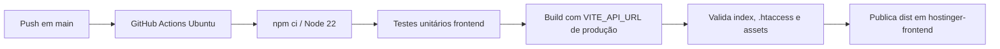
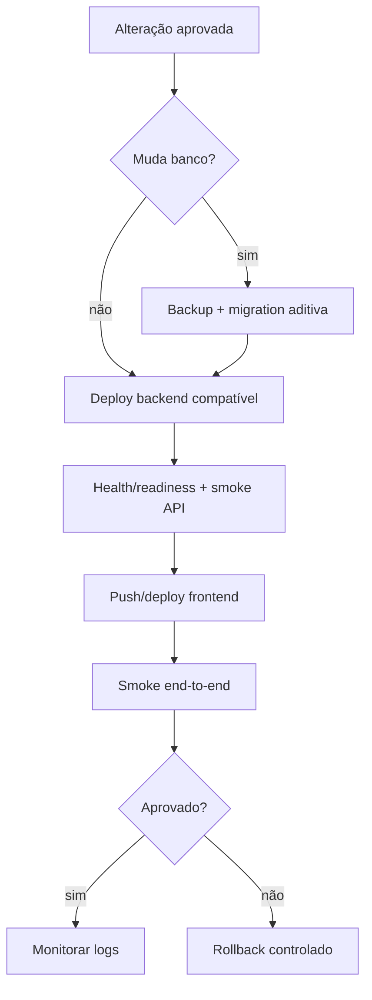

# Deploy, GitHub e Hostinger — runbook operacional

**Objetivo:** descrever o fluxo versionado, o comportamento observado e o procedimento seguro para frontend, backend, banco e arquivos persistentes.

## 1. Topologia de produção

| Componente | Endereço/serviço | Origem do artefato |
|---|---|---|
| Frontend SPA | `https://khalifadeveloper.com.br` | código raiz → `npm run build` → `dist/` |
| Backend API | `https://backendportfolio.khalifadeveloper.com.br` | `backend/` → `npm run build` → `backend/dist/` |
| Banco | MySQL/MariaDB Hostinger | `database/schema.sql` + migrations |
| Repositório | `apeetec/Sipat-Producao` | branch principal `main` |
| Mídia runtime | storage persistente do backend | `storage/uploads`, nunca Git |

O frontend e o backend são aplicações diferentes, em origens diferentes. Uma release que altera contrato pode exigir dois deploys e migration coordenada.

## 2. Branches auditadas

### `main`

- Branch padrão (`origin/HEAD -> origin/main`).
- Recebe o código-fonte integrado.
- Dispara `.github/workflows/deploy-frontend-hostinger.yml`.
- Pelo comportamento observado em 2026-11-02, commits novos nesta branch atualizaram o frontend de produção.
- Deve ser protegida por testes/build antes do push.

### `hostinger-frontend`

- Branch de artefato, não de desenvolvimento.
- Criada/atualizada pelo GitHub Actions com o conteúdo de `dist/`.
- Não deve receber edição, merge ou commit manual.
- Durante a auditoria, esteve temporariamente em `51179d1` (source `3638deb`) enquanto `main` já estava em `2a1d812`. Em seguida avançou para `c88fa4c`, artefato do source `2a1d812`, confirmando o funcionamento do workflow.

### `feature/event-date-categories`

- Branch histórica de feature, no commit `c812982`.
- Conteúdo já integrado em `main`.
- Não é branch de deploy.

## 3. A distinção entre o fluxo configurado e o fluxo observado

### 3.1 Automação versionada no GitHub

O workflow `deploy-frontend-hostinger.yml` roda em push para `main`:



O workflow fixa:

```text
VITE_API_URL=https://backendportfolio.khalifadeveloper.com.br
```

Ele valida que `dist/index.html` não referencia `/src/main.tsx`, prevenindo upload acidental do projeto fonte como se fosse site estático.

### 3.2 Comportamento observado da Hostinger

O site de produção recebeu alterações após pushes em `main`, e o GitHub Actions também comprovadamente transforma esses commits em artefatos na `hostinger-frontend`. Existem, portanto, duas topologias compatíveis com o comportamento observado:

- Hostinger conectada a `main`, executando o build no próprio serviço; ou
- Hostinger conectada a `hostinger-frontend`, recebendo o artefato produzido após cada push em `main`.

Git e o site público não distinguem sozinhos essas duas opções. As opções do hPanel não estão no repositório e precisam ser confirmadas visualmente antes de reconfigurar. O fato confirmado é que o fluxo `main` → GitHub Actions → `hostinger-frontend` está operacional.

## 4. Configuração esperada no hPanel para o frontend

Os nomes de menus variam com o plano e a versão do painel. Procure a área do site `khalifadeveloper.com.br`, integração Git/GitHub ou implantação.

Configuração coerente com o fluxo observado:

| Campo conceitual | Valor esperado |
|---|---|
| Provedor | GitHub |
| Repositório | `apeetec/Sipat-Producao` |
| Branch | `main` |
| Diretório raiz | raiz do repositório |
| Node | 22.x |
| Instalação | `npm ci` |
| Build | `npm run build` |
| Diretório público/output | `dist` |
| Auto deploy | habilitado para push em `main` |
| Variável de build | `VITE_API_URL=https://backendportfolio.khalifadeveloper.com.br` |

Se o hPanel estiver configurado para publicar diretamente uma branch sem build, use `hostinger-frontend` como branch e raiz como diretório público. Não combine os dois modelos sem necessidade.

### Modelo A — Hostinger compila `main` (observado/provável)

- Vantagem: um único branch de fonte.
- Requisito: plano/integração capaz de executar Node/Vite e servir `dist`.
- O GitHub Actions que gera `hostinger-frontend` torna-se redundante, mas pode servir como artefato/backup.

### Modelo B — Hostinger serve `hostinger-frontend`

- Vantagem: a hospedagem recebe somente arquivos estáticos prontos.
- Requisito: GitHub Actions funcionando; Hostinger conectada à branch de artefato.
- `main` nunca deve ser servido diretamente sem build.

Recomendação após confirmar o painel: escolher um único modelo autoritativo e registrar a decisão aqui.

## 5. Por que não se envia o projeto React inteiro para `public_html`

O navegador não executa TypeScript/JSX nem resolve dependências npm. O Vite transforma o projeto em:

```text
dist/
├── index.html
├── .htaccess
└── assets/
    ├── index-<hash>.js
    ├── index-<hash>.css
    └── chunks/imagens/fontes...
```

É normal haver apenas um `index.html`: a SPA usa JavaScript e React Router para renderizar todas as páginas. O `.htaccess` envia rotas não físicas para esse index.

## 6. `.htaccess` e Apache

`public/.htaccess` é copiado pelo Vite para `dist/.htaccess`. Ele:

- desabilita listagem de diretório;
- declara MIME de JS/CSS/SVG;
- preserva arquivos/diretórios existentes;
- reescreve as demais rotas para `index.html`;
- envia `nosniff` e outros headers;
- evita cache do HTML;
- aplica cache imutável aos assets com hash;
- habilita compressão quando disponível.

Se `/` funciona, mas `/login` direto retorna 404, verificar se `.htaccess` chegou ao diretório público e se `mod_rewrite`/AllowOverride estão habilitados.

Se JS retorna MIME `text/plain`, verificar:

1. se o HTML está referenciando um asset real em `dist/assets`;
2. se arquivos de source foram enviados em vez de `dist`;
3. se o servidor está entregando uma página de erro como JS;
4. regras MIME/cache da hospedagem.

## 7. Fluxo de release do frontend

### Antes do commit

```bash
npm ci
npm run verify
```

Verificações manuais:

- `.env` não rastreado;
- API URL correta e HTTPS;
- navegação responsiva;
- refresh em rota interna;
- formulário alterado envia o payload esperado.

### Commit e push

```bash
git status
git add <arquivos intencionais>
git commit -m "tipo: descrição objetiva"
git push origin main
```

Não usar `git add .` sem revisar. Não fazer force push em `main`.

### Pós-deploy

1. confirmar commit/build no GitHub e/ou histórico de deploy do hPanel;
2. abrir janela anônima para evitar Service Worker/cache de sessão;
3. acessar `/login` diretamente;
4. conferir no DevTools que assets têm hash novo e status 200;
5. testar settings, CORS, login e a tela alterada;
6. testar viewport móvel;
7. confirmar que nenhum request usa HTTP.

O `index.html` não deve ficar em cache longo. Assets com hash podem ficar por um ano.

## 8. Deploy do backend na Hostinger

### 8.1 Situação atual

Não existe workflow versionado comprovando deploy automático do backend. O processo atual é independente do frontend e foi operado por pacote de produção/ZIP ou aplicação Node da Hostinger.

### 8.2 Arquivos necessários

Para uma aplicação Node que executa build na Hostinger, enviar/conectar:

```text
backend/
├── package.json
├── package-lock.json
├── tsconfig.json
├── src/
├── ecosystem.config.cjs        # se PM2/VPS
├── deploy/                     # se proxy próprio
└── storage/                    # diretórios/volume, sem dados no pacote
database/
├── schema.sql
└── migrations/
```

O pacote de produção pode promover o conteúdo de `backend/` para sua raiz, como descrito em `backend/DEPLOY_PACKAGE.md`, para que o detector encontre `package.json`.

Nunca incluir:

- `.env` real;
- `node_modules`;
- logs;
- uploads existentes dentro de um ZIP substitutivo;
- outbox de e-mails;
- dumps com dados pessoais.

### 8.3 Configuração Node App

| Campo | Valor |
|---|---|
| Node | 22.x |
| Instalação | `npm ci` |
| Build | `npm run build` |
| Start | `npm start` |
| Entry compilada | `dist/server.js` |
| Health | `/api/health/ready` |

As variáveis são cadastradas no painel, não no Git. Em produção, `PUBLIC_BASE_URL` deve ser a origem HTTPS do backend e `CORS_ORIGINS` deve incluir a origem exata do frontend, sem path/barra final desnecessária.

### 8.4 PM2 em VPS

```bash
npm ci
npm run build
mkdir -p logs storage/uploads storage/outbox
pm2 start ecosystem.config.cjs
pm2 save
```

Use o Nginx de `backend/deploy/` como base e ajuste domínio/certificado/porta. Não exponha a porta Node diretamente se houver proxy.

### 8.5 Persistência de mídia

`UPLOAD_DIR` e `EMAIL_OUTBOX_DIR` devem apontar para diretórios persistentes. Se o deploy substitui a pasta inteira da aplicação:

- mover storage para volume/diretório externo; ou
- excluir `storage` da sincronização destrutiva; ou
- preservar e restaurar storage com verificação.

Deploy de código não é backup de mídia.

## 9. Deploy/migration do banco

### Instalação nova

1. criar o database pelo hPanel;
2. abrir phpMyAdmin;
3. selecionar o database;
4. importar `database/schema.sql`;
5. configurar `DATABASE_*` no Node;
6. executar bootstrap administrativo uma única vez;
7. remover variáveis `BOOTSTRAP_*` sensíveis;
8. testar readiness e login.

Em planos que não permitem `CREATE DATABASE`, selecione o banco criado no painel e importe somente as tabelas do schema, conforme permissões disponíveis.

### Instalação existente anterior às categorias

1. colocar aplicação em janela de manutenção;
2. exportar backup do banco;
3. testar o backup em banco separado;
4. importar `database/migrations/20261102_event_dates.sql`;
5. verificar sessões sem `event_date_id`;
6. publicar backend;
7. publicar frontend;
8. testar criação/edição/listagem;
9. retirar manutenção.

Ordem recomendada para mudanças compatíveis: migration aditiva → backend compatível → frontend. Remoções/renomes exigem estratégia expand/contract em releases separadas.

## 10. CORS, cookies e proxy

Para o ambiente atual:

- frontend origin: `https://khalifadeveloper.com.br`;
- backend origin: `https://backendportfolio.khalifadeveloper.com.br`;
- fetch precisa de `credentials: include` no fluxo de refresh;
- backend precisa responder ao `OPTIONS` com a origem permitida;
- `CORS_ORIGINS` não pode ser `*` com credenciais;
- `TRUST_PROXY=1` é esperado quando há proxy da Hostinger;
- cookie `Secure` exige HTTPS;
- não redirecionar preflight para login ou HTML.

Diagnóstico rápido:

```bash
curl -i -X OPTIONS "https://backendportfolio.khalifadeveloper.com.br/api/auth/login" \
  -H "Origin: https://khalifadeveloper.com.br" \
  -H "Access-Control-Request-Method: POST" \
  -H "Access-Control-Request-Headers: content-type"
```

Esperado: status de sucesso e `Access-Control-Allow-Origin` igual ao frontend, além de `Access-Control-Allow-Credentials: true`.

## 11. Release coordenada frontend/backend



Evite publicar frontend que exige endpoint ainda ausente. Quando necessário, implemente fallback transitório e remova após o backend estar confirmado.

## 12. Rollback

### Frontend

- Preferência: `git revert <commit>` em `main` e push, preservando histórico.
- Alternativa emergencial: redeploy de um build conhecido no hPanel.
- Não apagar histórico e não force-push.

### Backend

- Manter o pacote anterior identificado por commit e checksum.
- Restaurar pacote, executar `npm ci`, build e restart.
- Não sobrescrever storage.
- Confirmar health e contrato compatível com o frontend ativo.

### Banco

- Migration destrutiva não deve depender de rollback automático.
- Usar backup validado.
- Em migrations aditivas, frequentemente é mais seguro manter coluna/tabela e voltar só o código.
- Documentar toda correção manual e reconciliar schema/migration depois.

## 13. Checklist de produção

### Código

- [ ] `git status` contém apenas mudanças intencionais.
- [ ] `npm run verify:all` passou.
- [ ] OpenAPI/documentação atualizados.
- [ ] nenhum segredo/arquivo runtime rastreado.

### Banco/backend

- [ ] backup criado e validado, se houve migration.
- [ ] migration importada antes do código dependente.
- [ ] variáveis do hPanel conferidas.
- [ ] storage persistente preservado.
- [ ] `/api/health/live` e `/api/health/ready` retornam sucesso.
- [ ] Swagger/endpoint alterado responde como esperado.

### Frontend

- [ ] branch e commit do deploy confirmados.
- [ ] `VITE_API_URL` aponta para HTTPS correto.
- [ ] `.htaccess` presente no output.
- [ ] rota profunda abre diretamente.
- [ ] login/refresh e logout funcionam.
- [ ] sem CORS, mixed content, MIME ou 404 de asset.
- [ ] desktop e mobile verificados.

## 14. Informações que só o painel pode confirmar

Estas informações não estão versionadas e precisam ser registradas após inspeção do hPanel:

- nome exato do projeto/deployment na Hostinger;
- branch efetivamente conectada hoje;
- build/start/output configurados no painel;
- diretório público físico;
- política de auto deploy;
- diretório persistente de uploads;
- estratégia de logs/restart do Node;
- backup e retenção do banco;
- se backend também está conectado ao GitHub.

Não inventar esses valores. Atualize esta seção quando forem confirmados.
